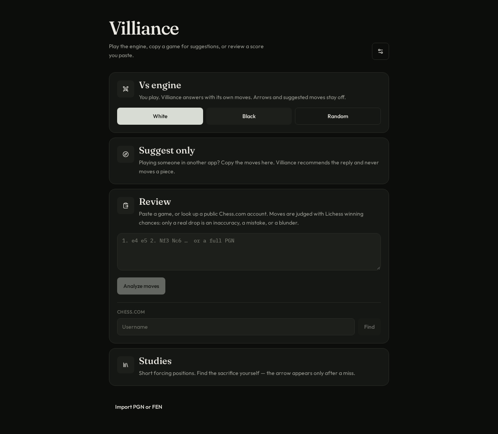
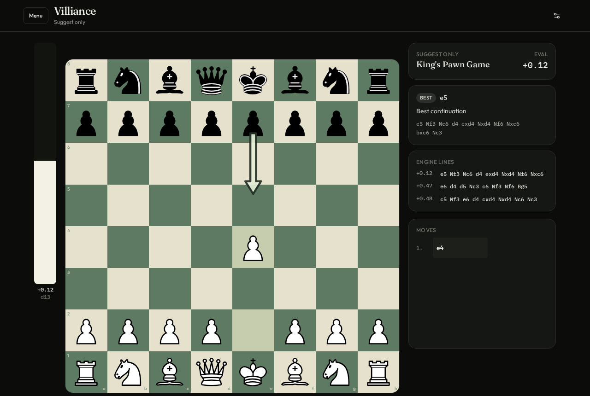
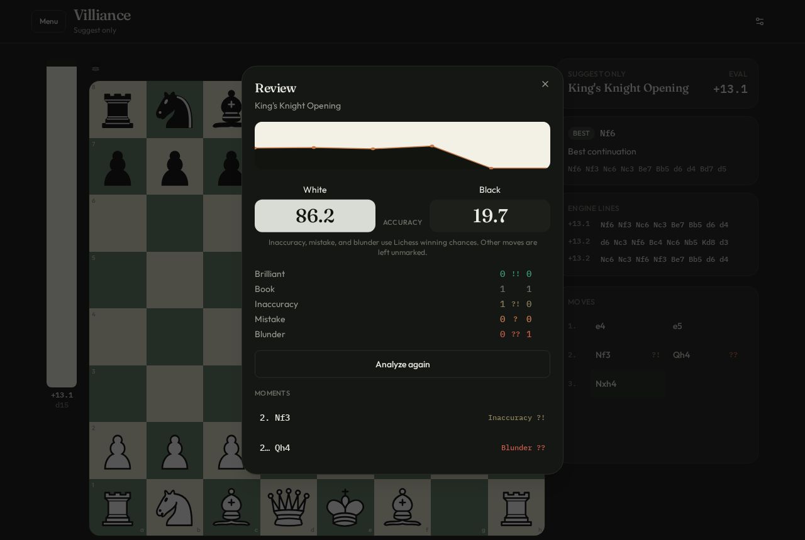
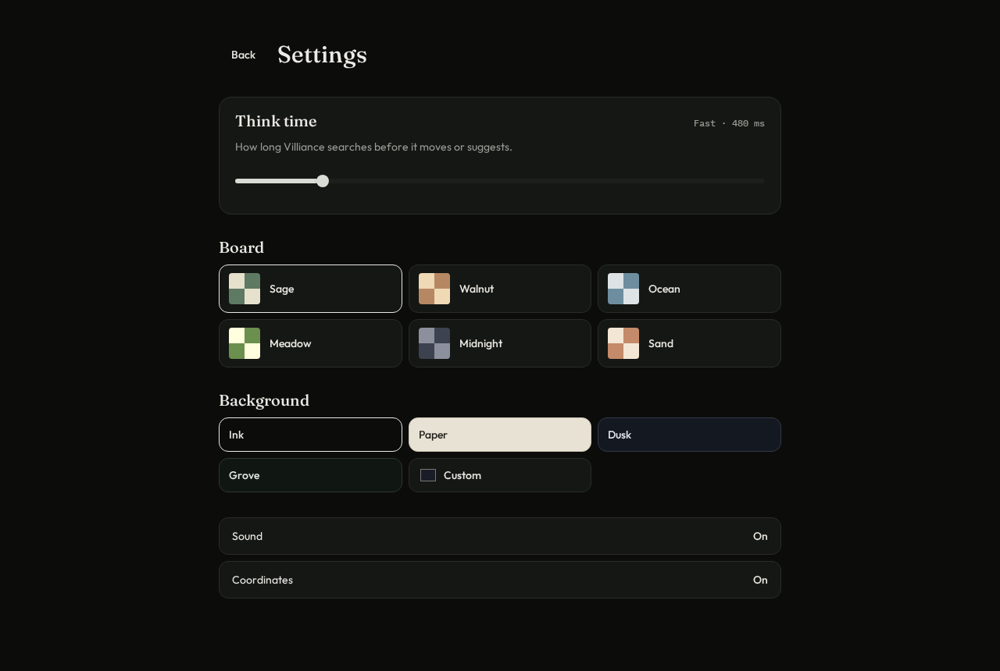

# Villiance

A chess board for playing the engine, copying a game from another app, or reviewing a score. The engine runs in the browser. Move marks follow [Lichess winning chances](https://github.com/lichess-org/lila).

Play it at [villiance.vercel.app](https://villiance.vercel.app).



## Play

**Vs engine.** You move. Villiance answers, from the opening book while the position is still theory. Suggestion arrows stay off. Strength is a rating, separate from how long it thinks. Add a clock, resign, or play on until the result.

**Suggest only.** You are playing someone somewhere else and copying the moves here. Villiance recommends a reply and never moves a piece for you. After each move it says what the engine wanted and what it cost. Two quieter arrows are the next choices, and an orange arrow is the threat if you do nothing. Paste a move, a game, or a position, or copy one and come back to the app.

**Review.** Paste moves, or look up a public Chess.com or Lichess account. Villiance walks the game, draws the evaluation, and marks only the moves that actually dropped. A blunder opens the position where it happened and shows the move to play instead. The review also says where you left the book. You can copy an annotated PGN or share the position.

**Studies.** Forcing patterns, plus any opening in the book. You pick a color and play that side. The other side answers from the line. A move that leaves the book is refused, and the book move is shown.

You can step backward and forward through the moves, flip the board, import a PGN or FEN, and copy the game back out. Pieces slide to their square instead of jumping.

<p>
  
  
</p>

## How a move is judged

The grade is the change in winning chances for the player who just moved, the same curve Lichess uses. A small drop is an inaccuracy. A larger one is a mistake. A collapse is a blunder. Book moves are named from the Lichess opening book, including transpositions. A move with nothing to mark is left unmarked.

A brilliant mark is extra. It is only offered on a sound sacrifice that holds the evaluation. It does not replace a Lichess error.

Accuracy on the review is the Lichess formula: each move is scored from the win percents before and after it, then the game is averaged with the same volatility weighting.

## Settings

Think time runs from a snap search to a serious one. Board colors are Sage, Walnut, Ocean, Meadow, Midnight, and Sand. The room behind the board can be Ink, Paper, Dusk, Grove, or a color you pick. Sound and coordinates can be turned off.

Support is [vyxorix@gmail.com](mailto:vyxorix@gmail.com). Games stay on the device.



## Android

Version 1.2 keeps the board, engine, studies, and pasted-game review inside the app, so those work with no connection. Chess.com and Lichess account lookup stays on the website. A new install is required when the board itself changes. The screen stays on while the app is open, and the phone back button leaves a game for the menu.

[Download Villiance.apk](https://github.com/Vyxorix/Villiance/releases/tag/v1.2) from the `v1.2` release. Android 7 or newer. Allow installs from the browser if the phone asks. It is signed for sideloading, not listed on the Play Store. The Android project is in `android/`.

## Run it yourself

```bash
npm install
npm run dev
```

Open [http://127.0.0.1:8080](http://127.0.0.1:8080).

The board is TypeScript. Positions use chess.js. Search is Stockfish compiled to WebAssembly. The deployed app is the same project on Vercel.
