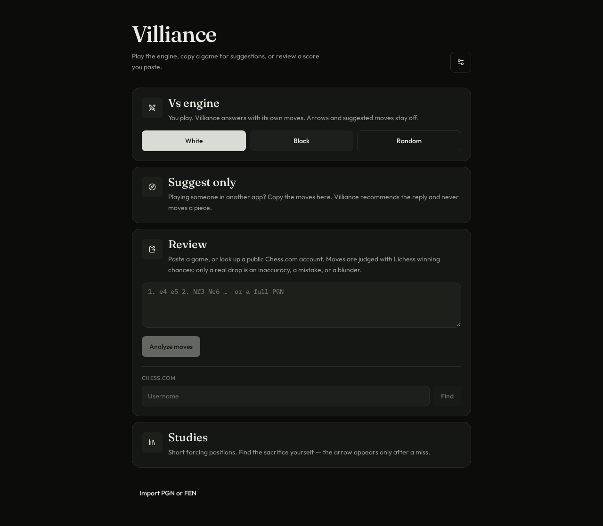
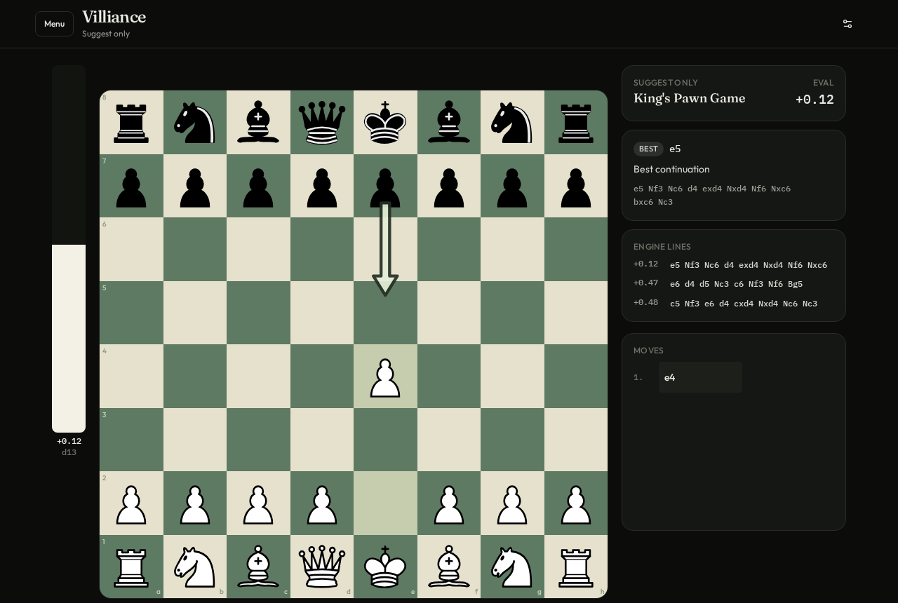
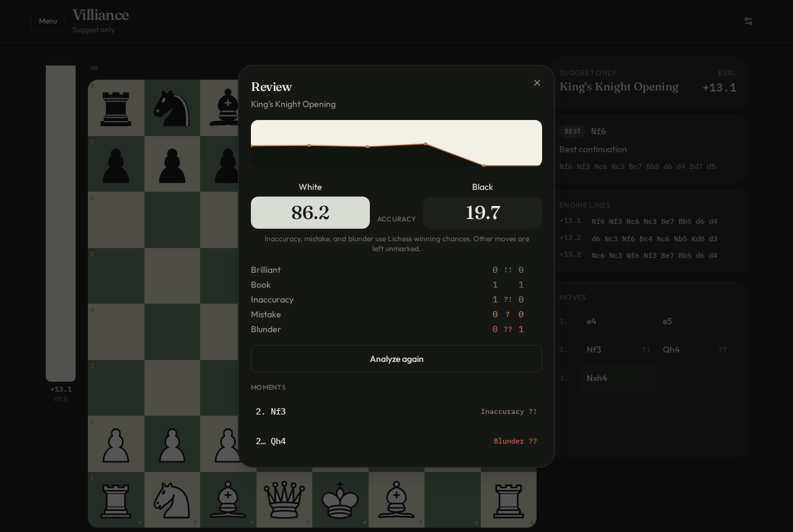
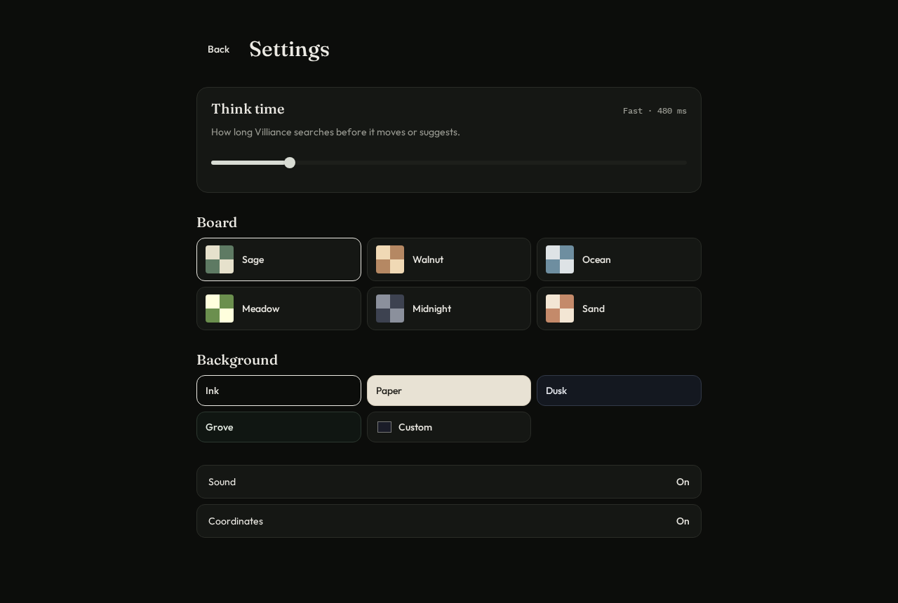

# Villiance

A chess board for playing the engine, copying a game from another app, or reviewing a score. The engine runs in the browser. Move marks follow [Lichess winning chances](https://github.com/lichess-org/lila).

Play it at [villiance.vercel.app](https://villiance.vercel.app).



## Play

**Vs engine.** You move. Villiance answers. Suggestion arrows stay off.

**Suggest only.** You are playing someone somewhere else and copying the moves here. Villiance recommends a reply and never moves a piece for you.

**Review.** Paste moves, or look up a public Chess.com username. Villiance walks the game, draws the evaluation, and marks only the moves that actually dropped.

**Studies.** Short forcing positions. The arrow stays hidden until you miss.

You can step backward and forward through the moves, flip the board, import a PGN or FEN, and copy the game back out.

<p>
  
  
</p>

## How a move is judged

The grade is the change in winning chances for the player who just moved, the same curve Lichess uses. A small drop is an inaccuracy. A larger one is a mistake. A collapse is a blunder. Book moves are named from the Lichess opening book, including transpositions. A move with nothing to mark is left unmarked.

A brilliant mark is extra. It is only offered on a sound sacrifice that holds the evaluation. It does not replace a Lichess error.

Accuracy on the review is the Lichess formula: each move is scored from the win percents before and after it, then the game is averaged with the same volatility weighting.

## Settings

Think time runs from a snap search to a serious one. Board colors are Sage, Walnut, Ocean, Meadow, Midnight, and Sand. The room behind the board can be Ink, Paper, Dusk, Grove, or a color you pick. Sound and coordinates can be turned off.



## Android

Version 1 is a small app that opens the site. It needs a network connection. Site updates show up without a new install.

[Download Villiance.apk](https://github.com/Vyxorix/Villiance/releases/tag/v1) from the `v1` release. Android 7 or newer. Allow installs from the browser if the phone asks. It is signed for sideloading, not listed on the Play Store.

## Run it yourself

```bash
npm install
npm run dev
```

Open [http://127.0.0.1:8080](http://127.0.0.1:8080).

The board is TypeScript. Positions use chess.js. Search is Stockfish compiled to WebAssembly. The deployed app is the same project on Vercel.
